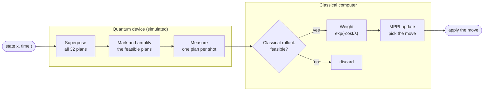
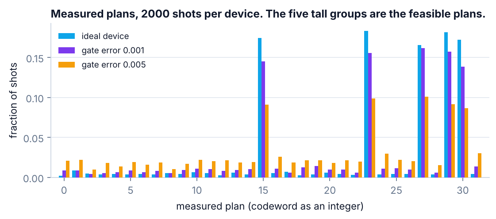
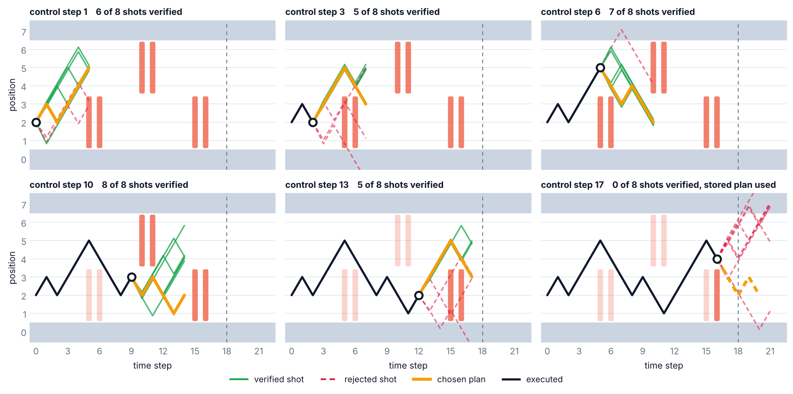
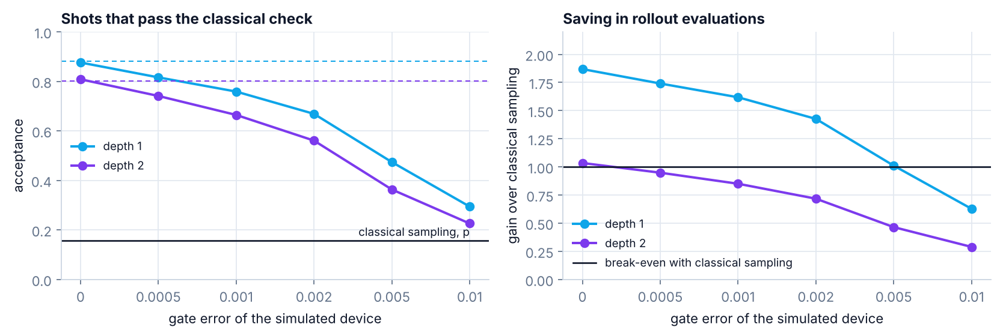
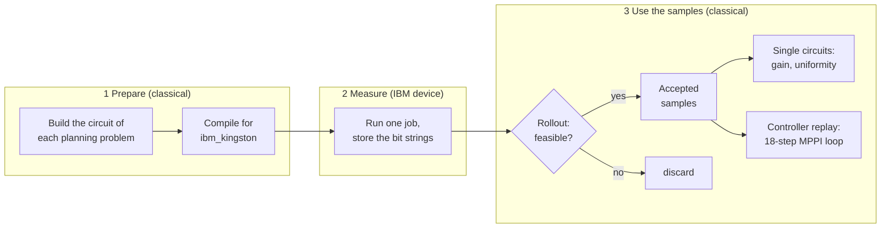

<h1 align="center">MPPI with a quantum sampler</h1>

<p align="center">
  <b>End-to-end model predictive path integral control in which a 12-qubit circuit proposes the trajectories<br>
  and a classical rollout verifies every one of them.</b><br>
  Simulated gate by gate with Qiskit Aer, with and without gate noise, and run on IBM Quantum hardware.
</p>

<p align="center">
  
</p>

<p align="center">
  <a href="tutorial.ipynb"><b>Tutorial notebook</b></a> ·
  <a href="docs/how_it_works.md"><b>How it works</b></a> ·
  <a href="results/"><b>Results</b></a> ·
  <a href="hardware/README.md"><b>Hardware runs</b></a> ·
  <a href="video/quantum_mppi_corridor.mp4"><b>Full video (76 s)</b></a>
</p>

---

## In one minute

* **The problem.** MPPI control draws random plans and averages the good ones. With hard constraints most
  plans are infeasible and are thrown away. With a tight budget the controller is often left with no
  usable plan at all.
* **The idea.** Let a quantum circuit *propose* the plans. A few Grover iterations make the feasible plans
  far more likely to be measured. A classical rollout then *verifies* each measured plan, and the usual
  MPPI average is formed from the verified ones.
* **The safeguard.** The device never decides feasibility. A faulty shot wastes budget, and it cannot put
  an unsafe plan into the average.

The task is small on purpose: 32 candidate plans per step, 12 qubits, an exact answer available by
enumeration. Every step can be read, run and checked in minutes.

## Results at a glance

Fraction of episodes in which a constraint is violated, in percent. Every sampler gets the same number of
rollout evaluations per control step. 300 episodes per entry.

| Sampler | 6 rollouts | 9 rollouts | 12 rollouts | 18 rollouts | 24 rollouts |
|---|---:|---:|---:|---:|---:|
| **classical sampling** | 12.3 | 4.3 | 3.3 | 0.3 | 0.0 |
| quantum, ideal device | 0.0 | 0.0 | 0.0 | 0.0 | 0.0 |
| **quantum, gate error 0.001** | 0.3 | 0.0 | 0.0 | 0.0 | 0.0 |
| quantum, gate error 0.005 | 7.0 | 2.0 | 0.7 | 0.3 | 0.0 |
| adaptive, ideal device | 1.3 | 0.0 | 0.0 | 0.0 | 0.0 |
| adaptive, gate error 0.001 | 3.3 | 0.0 | 0.0 | 0.0 | 0.0 |

<p align="center"></p>

* **Tight budget:** the amplified sampler fails far less often. Where feasible plans are rare, it almost
  always finds one.
* **Generous budget:** no sampler fails. The fixed-depth quantum sampler then has a slightly higher cost
  than classical sampling (12.5 against 11.4 at 24 rollouts), and the adaptive sampler matches it (11.4).
* **Blind spot:** where feasible plans are common, one Grover iteration overshoots. This is the flat blue
  curve in the right panel. The stored plan covers these steps, and the adaptive sampler removes them.
* **Gate noise** reduces the benefit. At a gate error of 0.005 the depth-1 circuit is close to break-even.

The standard error of the largest entries is about 1.9 percentage points.

## How one control step works



<p align="center"></p>

One Grover iteration takes the probability of measuring a feasible plan from 16 % to 88 % at the first
control step. The pictures are the actual amplitudes of the 32 plans, read from the simulator.

## Quick start

```bash
git clone https://github.com/das-goutam/quantum_mppi_demo.git
cd quantum_mppi_demo
pip install -r requirements.txt

python examples/01_show_circuit.py     # the circuit and its gate counts          (seconds)
python examples/02_single_update.py    # one MPPI update from quantum shots       (30 s)
python examples/03_closed_loop.py      # one episode, printed step by step        (10 s)
python examples/04_benchmark.py        # violation rate against budget            (15 min, --quick: 2 min)
python examples/05_noise_study.py      # how much gate noise the sampler takes    (2 min)

pytest                                 # the circuit against the classical model  (seconds)
python run_all.py                      # all of the above, output into results/
```

Times are for a two-core laptop. Python 3.10 or newer. Tested with Qiskit 2.6.2 and Qiskit Aer 0.18.4.

Prefer to read along? Open [`tutorial.ipynb`](tutorial.ipynb). It is stored with its outputs, so GitHub
shows every figure without running anything.

## Step by step

### Step 1. The circuit

`examples/01_show_circuit.py` builds the circuit of the first planning problem.

| Register | Qubits | Content |
|---|---|---|
| plan `z` | 5 | one qubit per move, 1 = up, 0 = down |
| position `y` | 2 | the position, stored as ⌊x/2⌋ |
| flags `f` | 5 | flag *t* is set if the position is unsafe after move *t* |

The reversible rollout below does on qubits what the model does on numbers. A plan is feasible exactly
when all flags stay zero.

<p align="center"></p>

One shot at depth 1 (one Grover iteration) compiles to **160 CNOT gates** and 222 single-qubit gates.

### Step 2. One MPPI update

`examples/02_single_update.py` checks the circuit against the theory, takes shots, verifies them, and
forms one update.

```
Probability that a shot returns a feasible plan
  depth   theory sin^2((2k+1) theta)   statevector of the circuit
  0       0.156250                     0.156250
  1       0.881348                     0.881348
  2       0.802040                     0.802040

2000 shots at depth 1, each one verified by a classical rollout
  device              accepted   counts on the 5 feasible plans (uniform is expected)
  ideal device        0.877      [349, 367, 331, 363, 344]
  gate error 0.001    0.758      [290, 311, 323, 315, 277]
  gate error 0.005    0.469      [182, 197, 202, 183, 173]

MPPI update with a budget of 12 rollout evaluations, 500 repetitions
  sampler                          no feasible sample   mean |nu_hat - nu|
  classical                         13.4 %              0.758
  quantum, depth 1, ideal            0.0 %              0.628
  quantum, depth 1, eta = 0.001      0.2 %              0.644
  quantum, depth 1, eta = 0.005      7.4 %              0.768
```

<p align="center"></p>

The verified shots are spread evenly over the five feasible plans, also with gate noise. Noise shows up as
a lower acceptance, not as a distorted sample.

### Step 3. One episode

`examples/03_closed_loop.py` runs the loop for 18 steps and prints every step.

```
=== quantum sampler (quantum, depth 1, ideal), budget 24 rollouts per step ===
t= 0  x=2  p=0.156  proposed= 8  accepted= 6  nu_hat=+0.232  nu_exact=+0.217  move=+1  (sampled)
t= 1  x=3  p=0.250  proposed= 8  accepted= 8  nu_hat=-0.070  nu_exact=-0.288  move=-1  (sampled)
t= 2  x=2  p=0.094  proposed= 8  accepted= 5  nu_hat=+1.000  nu_exact=+1.000  move=+1  (sampled)
t= 3  x=3  p=0.188  proposed= 8  accepted= 7  nu_hat=+1.000  nu_exact=+1.000  move=+1  (sampled)
...
t=15  x=5  p=0.594  proposed= 8  accepted= 1  nu_hat=-1.000  nu_exact=-0.950  move=-1  (sampled)
t=16  x=4  p=0.719  proposed= 8  accepted= 0  nu_hat=  n/a   nu_exact=-0.872  move=-1  (stored plan)
t=17  x=3  p=0.719  proposed= 8  accepted= 0  nu_hat=  n/a   nu_exact=-0.641  move=-1  (stored plan)
--> episode completed, cost 10.5, 432 rollout evaluations
```

`p` is the fraction of feasible plans, `proposed` the number of shots, `accepted` the number that passed the
classical check, `nu_hat` the estimated update and `nu_exact` the exact one.

<p align="center"></p>

The last panel shows a real limitation. When most plans are feasible, one Grover iteration overshoots and
no shot passes, so the controller follows its stored verified plan. The adaptive sampler avoids this
([details](docs/how_it_works.md#11-when-amplification-overshoots)).

### Step 4. Many episodes

`examples/04_benchmark.py` produces the table at the top. It also records how many control steps end
without any verified plan. At 6 rollouts per step:

| Sampler | Steps without a verified plan (%) | Episodes with a violation (%) |
|---|---:|---:|
| classical sampling | 22.6 | 12.3 |
| quantum, ideal device | 14.5 | 0.0 |
| quantum, gate error 0.001 | 14.1 | 0.3 |
| quantum, gate error 0.005 | 25.4 | 7.0 |
| adaptive, ideal device | 6.2 | 1.3 |
| adaptive, gate error 0.001 | 10.0 | 3.3 |

The adaptive sampler has the fewest empty steps. The fixed-depth sampler has more of them than its
violation rate suggests, because most fall in the easy last steps of the episode, where the stored plan is enough.

### Step 5. Gate noise

`examples/05_noise_study.py` measures what a verified sample costs as the device gets noisier.

<p align="center"></p>

| Gate error | Acceptance, depth 1 | Gain, depth 1 | Acceptance, depth 2 | Gain, depth 2 |
|---|---:|---:|---:|---:|
| 0 (ideal) | 0.876 | 1.87 | 0.808 | 1.03 |
| 0.0005 | 0.816 | 1.74 | 0.741 | 0.95 |
| 0.001 | 0.759 | 1.62 | 0.664 | 0.85 |
| 0.002 | 0.669 | 1.43 | 0.561 | 0.72 |
| 0.005 | 0.474 | 1.01 | 0.363 | 0.47 |
| 0.01 | 0.294 | 0.63 | 0.226 | 0.29 |
| classical sampling | 0.156 | 1.00 | | |

A gain above 1 means that the noisy circuit still saves rollout evaluations against classical sampling.
Depth 1 stays ahead up to a gate error of about 0.005. Depth 2 has twice as many gates and is never better
than depth 1 on this problem.

## On IBM Quantum hardware

The sampler was also run on `ibm_kingston` (156 qubits), in three jobs with 523,968 shots.
Scripts are in [`hardware/`](hardware/README.md) and the raw counts in `results/hardware/`.


| Finding | Numbers |
|---|---|
| Small circuits save rollouts | four circuits in both scans, gains 1.02 to 1.43 |
| The standard five-step circuits do not | gains 0.60 and 0.75 (scan A), 0.56 and 0.59 (scan B), at 309 and 327 two-qubit gates |
| Accepted samples are near uniform | total variation distance at most 0.036, uniformity rejected for 4 of 9 circuits per scan |
| Controller replay with device samples | 17.4% violations against 11.4% classical at six rollouts per step, equal from 18 |

The controller was replayed with samples measured on the device. It does not yet beat classical sampling
for the five-step horizon, and no computational advantage is shown. The stored counts can be re-analysed
without an IBM account: `python hardware/run_study.py report`.

### How the hardware experiment works



* **On the device.** Only stage 2 uses the quantum processor. Each job runs many circuits and returns the
  measured bit strings.
* **On a classical computer.** Everything else: building and compiling the circuits, checking every measured
  bit string with the rollout, the analysis, and the controller loop.
* **Controller replay.** The shots for all 28 planning problems of the task were measured first, in one job.
  The 18-step loop then ran classically and consumed those stored shots, each at most once per run. The
  processor was not queried during the loop, so this is not a real-time experiment.

## Repository map

```
quantum_mppi_demo/
├── README.md               this page
├── tutorial.ipynb          the whole method as an executed notebook
├── docs/how_it_works.md    the reasoning behind every step
├── qmppi/                  the package
│   ├── corridor.py         task and classical model, PlanningProblem.rollout is the verification
│   ├── circuits.py         reversible rollout, phase oracle, reflection, complete shot
│   ├── samplers.py         classical, quantum (Qiskit Aer, optional noise) and adaptive samplers
│   ├── mppi.py             MPPI update from verified samples, receding-horizon loop
│   └── plotting.py         shared figure style
├── examples/               the five steps
├── results/                console output and data of every step, results/hardware has the device counts
├── figures/                all pictures on this page
├── video/                  the explainer video and the script that renders it
├── hardware/               runs on IBM Quantum hardware: scripts and how to repeat them
├── tests/                  the circuit checked against the classical model
└── run_all.py              regenerate results/ and figures/
```

Two knobs cover most experiments: `QuantumSampler(depth=..., eta=...)` sets the number of Grover iterations
and the gate error, and `CorridorTask(...)` sets the obstacles, the horizon, the cost and the temperature.

## What this is and what it is not

| | |
|---|---|
| **It is** | a complete, checkable demonstration of the mechanism: circuit construction, amplification, verification, MPPI update, closed loop, noise |
| **It is not** | a real-time hardware experiment. The five steps run on a simulator. The device runs in `hardware/` are single circuits and a classical replay of the controller with stored device samples |
| **It is not** | a claim of quantum advantage. Cost is counted in rollout evaluations, and a reversible rollout on a quantum device costs far more elementary operations than a classical one |
| **It is not** | a hard instance. With 32 plans per step the exact update is computed by enumeration in `PlanningProblem.exact_update` |

Implementation notes

* The noise model is depolarizing noise after every compiled gate (parameter `eta` on CNOT gates, `eta/10`
  on single-qubit gates) and a flip with probability `eta` on every measured bit.
* The simulator is asked for shots in batches. Unused shots of a circuit are kept and handed out later, and
  every shot is used at most once.
* The loop has no recursive-feasibility guarantee. Failures are possible, and the benchmark measures how
  often they occur.

## Reference

This repository accompanies the line of work that started with

> G. Das and T. Tanaka, "Model Predictive Path Integral Control as a Quantum Query Problem,"
> *IEEE Control Systems Letters*, 2026. [arXiv:2607.28851](https://arxiv.org/abs/2607.28851)

See [`CITATION.cff`](CITATION.cff).
