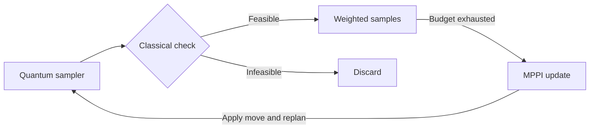
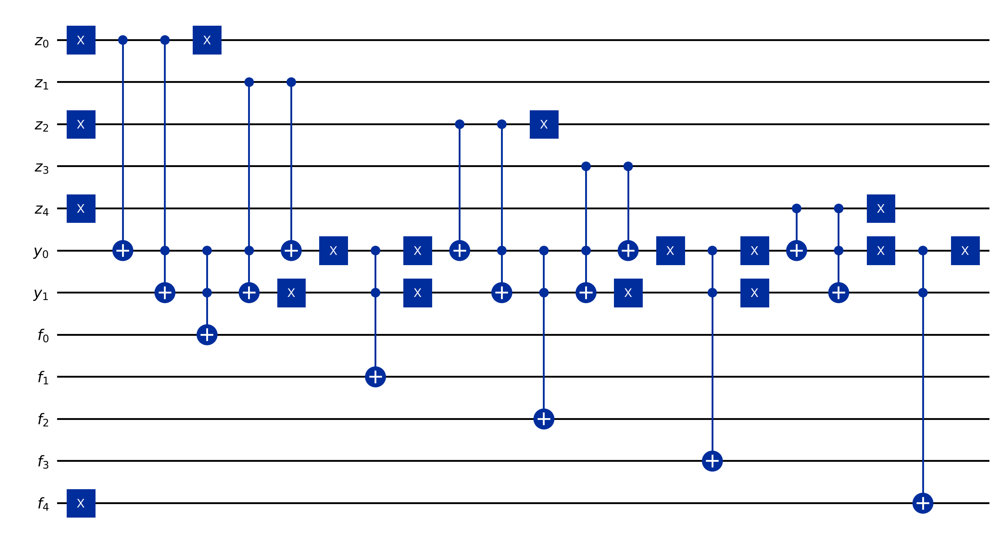
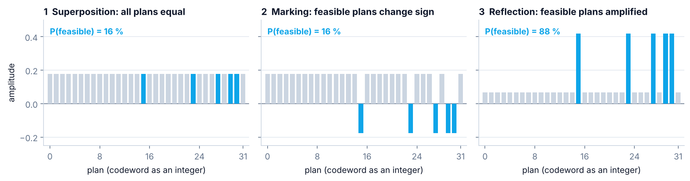
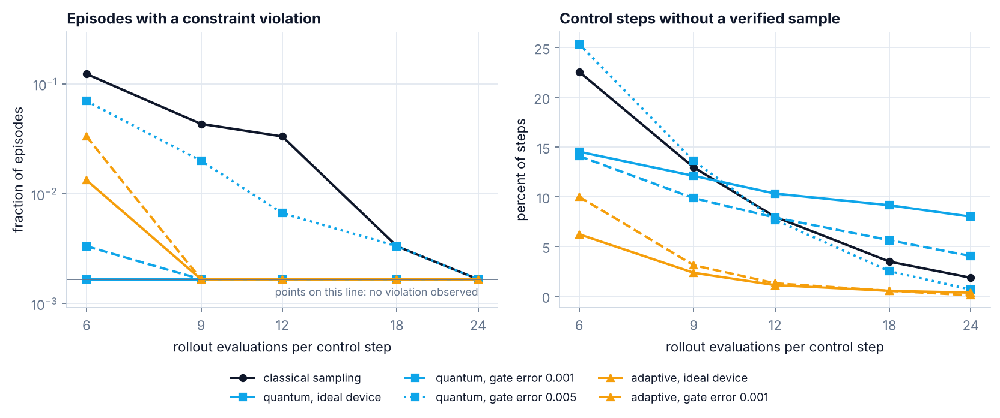
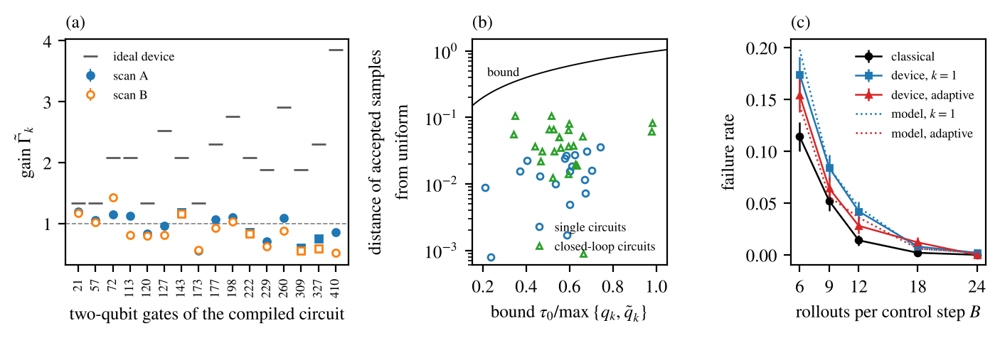

# MPPI with a quantum sampler

This repository implements constrained model predictive path integral (MPPI) control with a quantum trajectory sampler. A quantum circuit increases the probability of sampling a feasible input sequence. A classical rollout checks each measured sequence before it contributes to the weighted control update.

The implementation includes Qiskit Aer simulations, IBM Quantum circuit measurements, and a classical controller replay using stored hardware samples. The five-step corridor example has 32 candidate sequences and uses a 12-qubit standard circuit. Its small size allows comparison with the exact control update.

<p align="center">
  
</p>

[Tutorial notebook](tutorial.ipynb) · [Method](docs/how_it_works.md) · [Results](results/) · [Hardware experiments](hardware/README.md) · [Video](video/quantum_mppi_corridor.mp4)

## Method

MPPI estimates a control update from sampled input sequences, with lower-cost trajectories receiving larger weights. Hard constraints exclude infeasible trajectories. When feasible sequences are rare, a limited sampling budget can leave the controller without a usable plan.

The quantum sampler uses amplitude amplification, implemented through Grover iterations, to increase the probability of measuring a feasible sequence. Each iteration evaluates feasibility coherently within the circuit. After measurement, the classical model checks the sequence again and rejects it if any constraint is violated.

Classical verification prevents infeasible model trajectories from entering the weighted average. It does not remove noise-induced bias among accepted samples or establish safety over the full control episode.



Sampling and verification repeat within the rollout budget. The controller then forms one update from the accepted samples and applies one move. If no sample is accepted, it uses the fallback described below.

For accepted sequences indexed by $i$, the estimated first-step update is

$$
\widehat\nu=\frac{\sum_i w_i u_{i,0}}{\sum_i w_i},
\qquad w_i=\exp(-S_i/\lambda).
$$

Here, $u_{i,0}\in\{-1,+1\}$ is the first move, $S_i$ is the trajectory cost, and $\lambda>0$ controls the relative weights. The corridor controller executes the sign of this estimate and stores a compatible accepted plan. If the estimate is zero, it uses the cheapest accepted plan. If no sample is accepted, it follows its stored plan. If no stored move remains, it chooses a random move.

The adaptive sampler first tries three classical proposals. If all fail, it uses the remaining budget for one-iteration quantum proposals.

## Installation and examples

Use Python 3.10 or newer. The recorded environment uses Qiskit 2.6.2 and Qiskit Aer 0.18.4.

```bash
git clone https://github.com/das-goutam/quantum_mppi_demo.git
cd quantum_mppi_demo
python -m pip install -r requirements.txt

python examples/01_show_circuit.py
python examples/02_single_update.py
python examples/03_closed_loop.py
python examples/04_benchmark.py --quick
python examples/05_noise_study.py
python -m pytest
```

Run `examples/04_benchmark.py` without `--quick` for the full benchmark. Run `python run_all.py` to regenerate the simulation results and figures. Execution time depends on the computer and simulator settings.

The [tutorial notebook](tutorial.ipynb) includes saved outputs. The [method notes](docs/how_it_works.md) provide the derivation and implementation details.

## Simulation experiments

### 1. Circuit construction

`examples/01_show_circuit.py` builds the first planning problem, with five moves and 32 possible input sequences.

| Register | Qubits | Representation |
|---|---:|---|
| Sequence `z` | 5 | One bit per move, with 1 for up and 0 for down |
| Position `y` | 2 | Position stored as $\lfloor x/2\rfloor$ |
| Violation flags `f` | 5 | One flag per prediction step |

The reversible rollout records constraint violations. A sequence is feasible when all flags are zero. The circuit then reverses the rollout to clear the work registers before completing the amplification step.

<p align="center"></p>

In the reported simulator compilation, a one-iteration circuit has 160 CNOT gates and 222 single-qubit gates. Hardware compilation produces different counts because it uses the processor's native gates and connectivity.

The code parameter `depth` denotes the number of Grover iterations. It is distinct from the compiled circuit depth, which counts sequential gate layers.

### 2. Sampling and the control update

`examples/02_single_update.py` compares the circuit with the ideal amplification formula and estimates one control update from measured samples.

At the initial state, five of the 32 sequences are feasible. If $p$ is the feasible fraction and $k$ is the number of Grover iterations, the ideal acceptance probability is

$$
q_k=\sin^2\!\left((2k+1)\arcsin\sqrt{p}\right).
$$

| Grover iterations $k$ | Ideal formula | Circuit statevector |
|---:|---:|---:|
| 0 | 0.156250 | 0.156250 |
| 1 | 0.881348 | 0.881348 |
| 2 | 0.802040 | 0.802040 |

One iteration raises acceptance from 15.6% to 88.1%. A second iteration reduces it for this instance.

<p align="center"></p>

The following results use 2,000 shots per setting. A shot is one circuit execution and measurement.

| Simulator setting | Accepted fraction | Counts on the five feasible sequences |
|---|---:|---|
| Ideal | 0.877 | 349, 367, 331, 363, 344 |
| Gate-noise parameter 0.001 | 0.758 | 290, 311, 323, 315, 277 |
| Gate-noise parameter 0.005 | 0.469 | 182, 197, 202, 183, 173 |

<p align="center"></p>

Ideal amplification preserves uniform sampling among feasible sequences. The simulated noisy counts are close to uniform, but finite samples do not establish exact uniformity. The theoretical uniformity result assumes global depolarizing noise. Local gate noise and hardware errors can change the relative frequencies of accepted sequences.

### 3. Receding-horizon control

`examples/03_closed_loop.py` runs an 18-step episode with a five-step prediction horizon. At each step, it samples candidate sequences, verifies them, computes the update, and applies one move.

The printed output records the feasible fraction `p`, proposed and accepted sample counts, the estimated update `nu_hat`, the exact update `nu_exact`, and whether the move came from new samples or a stored plan.

<p align="center"></p>

When feasible sequences are common, a fixed Grover iteration can reduce acceptance. This occurs near the end of the example episode, where the controller sometimes relies on its stored plan. The adaptive sampler reduces this effect by trying classical proposals first, but it does not eliminate the possibility of an empty sample set.

### 4. Closed-loop benchmark

`examples/04_benchmark.py` compares constraint violations at equal rollout budgets. A classical proposal costs one rollout. A quantum proposal with $k$ iterations is charged $2k+1$ rollout evaluations, accounting for the forward and inverse quantum rollouts and the classical verification. This accounting compares model queries, not elapsed runtime or elementary gate operations.

The table gives the percentage of episodes with at least one constraint violation. Each entry uses 300 episodes from [`results/benchmark.json`](results/benchmark.json).

| Sampler | 6 rollouts | 9 rollouts | 12 rollouts | 18 rollouts | 24 rollouts |
|---|---:|---:|---:|---:|---:|
| Classical | 12.3 | 4.3 | 3.3 | 0.3 | 0.0 |
| Quantum, ideal | 0.0 | 0.0 | 0.0 | 0.0 | 0.0 |
| Quantum, noise parameter 0.001 | 0.3 | 0.0 | 0.0 | 0.0 | 0.0 |
| Quantum, noise parameter 0.005 | 7.0 | 2.0 | 0.7 | 0.3 | 0.0 |
| Adaptive, ideal | 1.3 | 0.0 | 0.0 | 0.0 | 0.0 |
| Adaptive, noise parameter 0.001 | 3.3 | 0.0 | 0.0 | 0.0 | 0.0 |

<p align="center"></p>

At six rollouts per step, the one-iteration sampler reduces the observed violation rate from 12.3% to 0.3% at noise parameter 0.001. The standard error of the classical rate is about 1.9 percentage points. At 24 rollouts, no violations were observed for any sampler. Zero observed violations do not imply zero failure probability.

Fewer violations do not necessarily imply a lower trajectory cost. At 24 rollouts, the ideal one-iteration sampler has mean cost 12.5, compared with 11.4 for classical sampling and 11.4 for the ideal adaptive sampler, rounded to one decimal place.

### 5. Noise and rollout cost

`examples/05_noise_study.py` measures acceptance and rollout cost for the initial planning problem, using 3,000 shots per setting.

The simulation applies depolarizing noise with parameter `eta` after each CNOT gate and `eta/10` after each single-qubit gate. Each measured bit is also flipped with probability `eta`. These parameters specify the simulation model, rather than measured device error rates.

<p align="center"></p>

| Noise parameter | Acceptance, $k=1$ | Gain, $k=1$ | Acceptance, $k=2$ | Gain, $k=2$ |
|---:|---:|---:|---:|---:|
| 0 | 0.876 | 1.87 | 0.808 | 1.03 |
| 0.0005 | 0.816 | 1.74 | 0.741 | 0.95 |
| 0.001 | 0.759 | 1.62 | 0.664 | 0.85 |
| 0.002 | 0.669 | 1.43 | 0.561 | 0.72 |
| 0.005 | 0.474 | 1.01 | 0.363 | 0.47 |
| 0.01 | 0.294 | 0.63 | 0.226 | 0.29 |

Rollout-count gain is the classical expected cost per accepted sequence divided by the quantum expected cost. Its estimate is $\widehat q_k/[(2k+1)p]$, where $\widehat q_k$ is the measured accepted fraction. A value above one indicates fewer counted rollouts per accepted sequence.

The one-iteration estimate is close to break-even at noise parameter 0.005 and below one at 0.01. Two iterations give lower gain than one at every tested noise level. These comparisons apply to this problem and noise model.

## IBM Quantum experiments

Three jobs on `ibm_kingston` contain 523,968 shots across two circuit scans and one collection of controller samples. The scan circuits use 5 to 12 qubits. Scripts and instructions are in [`hardware/`](hardware/README.md), and raw counts are in [`results/hardware/`](results/hardware/).



| Measurement | Result |
|---|---|
| Small-circuit rollout gain | Four circuits exceed unit gain by more than three nominal standard errors in both scans. Their measured gains range from 1.02 to 1.43. |
| Standard five-step circuits | Gains are 0.60 and 0.75 in scan A, and 0.56 and 0.59 in scan B. The circuits use 309 and 327 two-qubit gates. |
| Accepted distributions | The largest empirical total variation distance from uniform is 0.036. Small deviations can still be statistically significant. |
| Controller replay at six rollouts per step | The one-iteration hardware sampler has 17.4% violations, compared with 11.4% for classical sampling, over 500 episodes per entry. |

Total variation distance measures the difference between probability distributions. The reported value is computed from the accepted-sample histogram, so it is an empirical estimate. The nominal standard errors used for circuit gains do not correct for testing multiple circuits.

### Controller replay procedure

1. Construct and compile circuits for 28 state–time planning problems.
2. Measure the circuits on the processor and store a separate sample pool for each problem.
3. Run the 18-step controller classically, drawing from the pool for the current planning problem.
4. Verify each sequence and compute the control update from accepted samples.

Of the 28 planning problems, 24 have feasible plans. Their reduced circuits use 154 to 217 two-qubit gates. Each stored shot is used at most once within a sampler–budget entry. Pools are reset across entries, so the comparisons reuse hardware data.

The processor is not queried during the controller replay. The experiment therefore evaluates control decisions based on stored device samples, without measuring live controller latency. Hardware samples perform worse than classical sampling at the smallest budget. The differences decrease at larger budgets, but the recorded rates are not identical from 18 rollouts onward.

The counts can be analysed without an IBM account. The `report` command recomputes the analysis, rewrites the selected JSON files, and regenerates their figures. Run it on copies to preserve the committed results used in the papers:

```bash
report_dir=$(mktemp -d)
cp results/hardware/scan_*.json results/hardware/loop_*.json "$report_dir/"
python hardware/run_study.py report "$report_dir"/*.json
```

The recomputed files and figures are saved in the temporary directory. The analysis uses fixed random seeds, so repeated runs with the same inputs, code, and numerical environment should be reproducible. Resampling-based statistics can differ from the archived values when the code or environment changes.

## Scope and limitations

The examples demonstrate circuit construction, feasibility amplification, classical verification, and the resulting control update. The reported gains concern rollout counts. Quantum gate cost, compilation, device access, and execution time must also be considered when assessing computational performance.

The corridor is small enough to solve exactly by enumeration through `PlanningProblem.exact_update`. These experiments do not establish an advantage over the best classical solution method.

Verification applies to the stated model and prediction horizon. The controller has no recursive-feasibility guarantee, and the experiments measure how often constraint violations occur. Noise can also bias the accepted distribution and the weighted update even when every accepted trajectory is feasible.

## Repository contents

| Path | Contents |
|---|---|
| `tutorial.ipynb` | Tutorial with saved outputs |
| `docs/how_it_works.md` | Derivation and implementation details |
| `qmppi/corridor.py` | Task, classical rollout, and exact update |
| `qmppi/circuits.py` | Reversible rollout, phase oracle, and amplification circuit |
| `qmppi/samplers.py` | Classical, quantum, and adaptive samplers |
| `qmppi/mppi.py` | Weighted update and receding-horizon controller |
| `qmppi/plotting.py` | Plotting functions |
| `examples/` | Five simulation experiments |
| `results/` | Stored simulation results and hardware counts |
| `figures/` | Figures used in this README |
| `hardware/` | IBM experiment and analysis scripts |
| `tests/` | Circuit checks against the classical model |
| `video/` | Demonstration video and rendering script |
| `run_all.py` | Simulation and figure generation |

`QuantumSampler(depth=..., eta=...)` sets the number of Grover iterations and the simulation noise parameter. `CorridorTask(...)` sets the obstacles, prediction horizon, cost, and temperature. Simulator shots are generated in batches and retained for later use, with each shot consumed at most once within a run.

## Reference

The earlier quantum-query formulation is described in:

> G. Das and T. Tanaka, “Model Predictive Path Integral Control as a Quantum Query Problem,” *IEEE Control Systems Letters*, 2026. [arXiv:2607.28851](https://arxiv.org/abs/2607.28851)

The present implementation uses amplitude amplification to generate samples, followed by a classical weighted update. See [`CITATION.cff`](CITATION.cff) for citation metadata.
