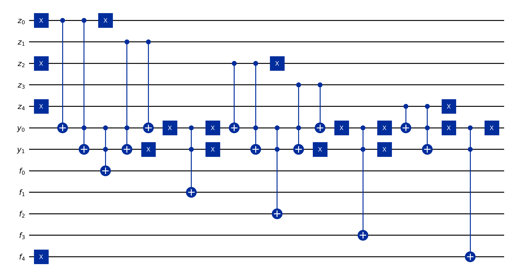
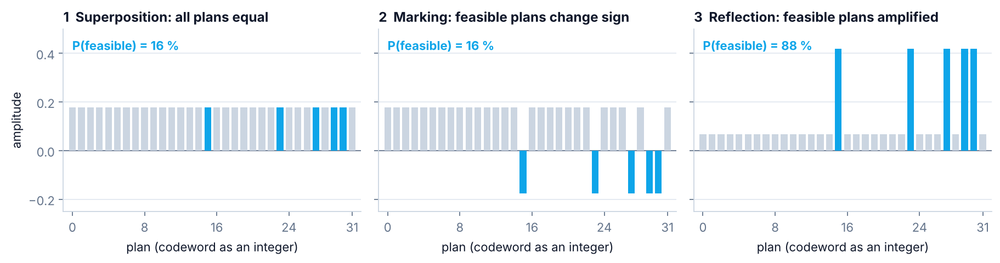
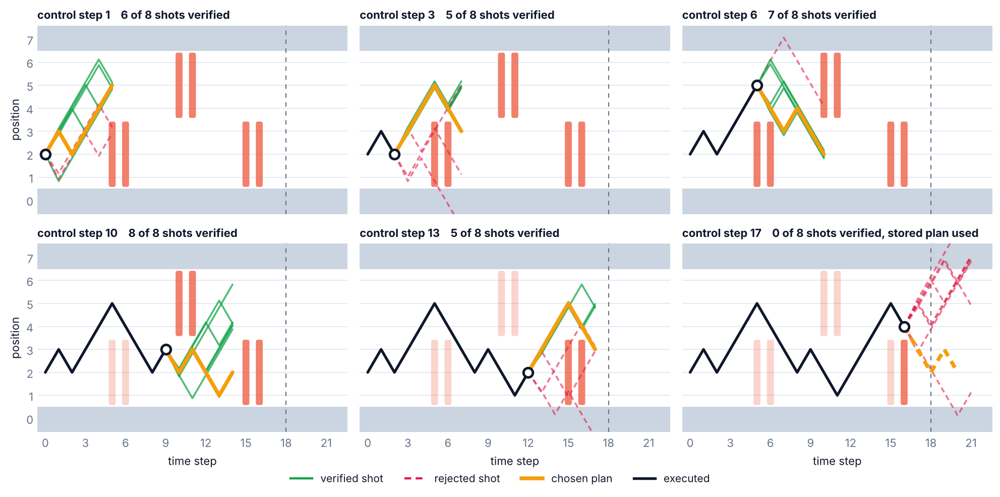
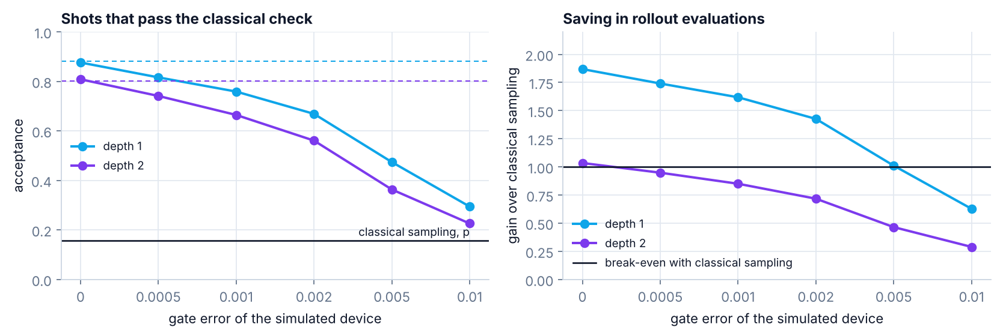

# How it works

This page explains the reasoning behind every step of the demo. The [tutorial notebook](../tutorial.ipynb)
shows the same steps as running code.

**Contents**

1. [The control problem](#1-the-control-problem)
2. [Why hard constraints waste samples](#2-why-hard-constraints-waste-samples)
3. [The idea: split the work](#3-the-idea-split-the-work)
4. [Plans as qubits](#4-plans-as-qubits)
5. [The reversible rollout](#5-the-reversible-rollout)
6. [Amplification](#6-amplification)
7. [Verification](#7-verification)
8. [The MPPI update and the loop](#8-the-mppi-update-and-the-loop)
9. [What a shot costs](#9-what-a-shot-costs)
10. [Gate noise](#10-gate-noise)
11. [When amplification overshoots](#11-when-amplification-overshoots)
12. [Scope](#12-scope)
13. [Glossary](#13-glossary)

---

## 1. The control problem

A point moves on the positions $0,\dots,7$ and steps by $+1$ or $-1$ at every time step:

$$x_{t+1} = x_t + \epsilon_t, \qquad \epsilon_t \in \{-1,+1\}.$$

Positions 1 to 6 are safe, positions 0 and 7 are walls, and obstacles block half of the corridor at fixed
times. The stage cost is $0.5\,|x-2|$. An episode has 18 control steps.

The controller is **model predictive path integral (MPPI) control**. At every step it

1. samples candidate plans for the next $N=5$ moves,
2. simulates each plan with the model (a *rollout*),
3. averages the first moves of the plans with the weights $g = e^{-S/\lambda}$, where $S$ is the cost of a
   plan and $\lambda$ the temperature,
4. applies one move and repeats from the new state.

## 2. Why hard constraints waste samples

A plan that touches a wall or an obstacle is **infeasible** and gets weight zero. Only feasible plans
count:

$$\nu \;=\; \frac{\sum_{z\ \text{feasible}} g(z)\,\epsilon_0(z)}{\sum_{z\ \text{feasible}} g(z)}, \tag{1}$$

where $\epsilon_0(z)$ is the first move of plan $z$. The controller moves up if $\nu>0$ and down if $\nu<0$.

Let $p$ be the fraction of feasible plans. A classical sampler that draws $B$ random plans keeps about
$pB$ of them, and keeps **none** with probability $(1-p)^B$. At the first step of this task $p = 5/32$, so
with $B=6$ the controller has no feasible sample in 36 % of the tries. A step without a sample is a step
without an update, and several of them in a row end in a collision.

## 3. The idea: split the work

Feasibility is the rare event. The cost weighting is easy once feasible plans are available. So the work
is split:

| | Quantum device | Classical computer |
|---|---|---|
| Job | **Propose** plans, with feasible ones made likely | **Verify** every proposal, weight it, average |
| Tool | Amplitude amplification (Grover iterations) | One rollout per proposal, then equation (1) |
| Can a mistake make a plan unsafe? | It can waste a shot | No. The check is exact |

The device never computes a weight and never decides feasibility. This keeps the circuit short and makes
its errors harmless for safety.

## 4. Plans as qubits

A plan is a string of $N$ bits, $z_t = 1$ for a move up and $z_t = 0$ for a move down. We call it a
**codeword**. The circuit has one **sign qubit** per bit. A Hadamard gate on every sign qubit creates the
state

$$|\sigma\rangle = \frac{1}{\sqrt{2^N}} \sum_{z} |z\rangle ,$$

an equal superposition of all $2^N$ plans. Measuring it right away returns a uniformly random plan, which is
exactly classical sampling.

## 5. The reversible rollout

To tell feasible from infeasible plans, the circuit has to simulate the model on all plans at once. It
uses two more registers:

| Register | Qubits | Content |
|---|---|---|
| position `y` | 2 | $\lfloor x/2 \rfloor$ |
| flags `f` | $N$ | flag $t$ is 1 if the position is unsafe after move $t$ |

**The parity trick.** After $t$ moves the position has the parity of $x_0 + t$, so its lowest bit is known
without a qubit. Only $y=\lfloor x/2\rfloor$ needs to be stored, in two qubits. A time step then is

* from an even position: decrement $y$ if the move is down,
* from an odd position: increment $y$ if the move is up.

Each is a controlled two-bit counter: one Toffoli gate and one CNOT gate. After the step, one or two gates
set the flag from the two bits of $y$.

*The rollout of the first planning problem. Wires `z` are the plan, `y` the position, `f` the flags.*

The walls 0 and 7 are always flagged, so a path is flagged before the two-bit counter could wrap around.
A plan is feasible exactly when **all flags are zero**. The tests check this against the classical model
for every plan.

## 6. Amplification

One **Grover iteration** has two halves.

**Mark.** Run the rollout, multiply the state by $-1$ if all flags are zero, and run the rollout backwards.
The backward pass returns the position and the flags to their initial values. The net effect is a sign flip
on the amplitude of every feasible plan.

**Reflect.** Reflect all amplitudes about their mean. A plan with amplitude $a$ gets $2\bar a - a$. The
feasible plans, which sit below the mean after the sign flip, end up far above it.

*Amplitudes of the 32 plans, read from the simulator after each stage (first control step).*

With $\sin^2\theta = p$, a measurement after $k$ iterations returns a feasible plan with probability

$$\alpha_k = \sin^2\big((2k+1)\,\theta\big), \tag{2}$$

and all feasible plans are equally likely. At the first step $p = 0.156$ becomes $\alpha_1 = 0.881$.
Equation (2) oscillates in $k$, so more iterations are not always better.

## 7. Verification

Each shot returns one plan. The controller rolls it out classically, exactly as it would for a classical
sample, and drops it if it is infeasible.

This one step has three consequences.

* No infeasible plan reaches the average, whatever the device did.
* The verification returns the cost of the plan, which the weight needs anyway.
* A faulty shot is not a wrong answer. It is a wasted proposal.

## 8. The MPPI update and the loop

The verified plans go into equation (1) in place of the classical samples. The lattice allows only the
moves $\pm 1$, so the controller executes the sign of the estimate $\hat\nu$. At least one verified plan
starts with that move, and the cheapest of them is stored.

If no shot passes the check, the controller follows the rest of the stored plan. If there is none, it moves
at random. An episode fails when the state leaves the safe set.

*Six control steps of one episode. Green: verified shots. Red: rejected shots. Gold: the stored plan.*

This rule keeps the next state safe whenever a verified plan exists. It does not guarantee that a feasible
plan will exist at the following step. Failures are therefore possible, and their frequency is what the
benchmark measures.

## 9. What a shot costs

All budgets are counted in **rollout evaluations**, the number of times the model is run over the planning
horizon.

| Proposal | Rollouts | Why |
|---|---|---|
| classical sample | 1 | its verification |
| shot at depth $k$ | $2k+1$ | each iteration runs the rollout forward and backward, plus one verification |

A depth-1 shot costs 3. It pays off when its acceptance is more than three times the classical one,
$\alpha_1 > 3p$. With a budget of 12 the comparison is 12 classical samples against 4 shots.

## 10. Gate noise

`QuantumSampler(eta=...)` adds depolarizing noise after every compiled gate (parameter `eta` on CNOT
gates, `eta/10` on single-qubit gates) and flips every measured bit with probability `eta`. The depth-1
circuit has 160 CNOT gates, so at `eta = 0.001` about one shot in six contains a fault.

*Left: fraction of shots that pass the check. Right: saving in rollouts relative to classical sampling.*

In these simulations noise does two things and avoids a third.

* It lowers the acceptance, because a faulty shot often returns an infeasible plan.
* It favors shallow circuits. Depth 2 has twice the gates and loses its advantage sooner.
* It does not visibly distort the verified samples. They stay spread evenly over the feasible plans
  (see `results/05_noise_study.txt`).

The break-even is where the acceptance has dropped to $3p$. For this problem that is near `eta = 0.005`.

## 11. When amplification overshoots

Equation (2) rotates the state by a fixed angle per iteration. If feasible plans are already common, one
iteration rotates past them. At $p \approx 0.72$, which occurs at the end of the episode, $\alpha_1$ is
about 1 %.

The fixed-depth sampler then gets no verified shot and relies on the stored plan (last panel of the
storyboard). The `AdaptiveSampler` avoids this. It first draws three classical samples and uses the circuit
only when none of them is feasible.

## 12. Scope

* **Simulation only.** No quantum hardware is involved.
* **No speed-up in time is claimed.** The budget counts rollout evaluations. A reversible rollout on a
  quantum device costs far more elementary operations than a classical one.
* **The task is easy for a classical computer.** With 32 plans per step the exact update is computed by
  enumeration (`PlanningProblem.exact_update`). The task is a test bed in which every number can be checked.
* **No recursive feasibility.** See Section 8.

## 13. Glossary

| Term | Meaning |
|---|---|
| plan, codeword | a sequence of $N$ moves, stored as $N$ bits |
| rollout | one simulation of the model over the planning horizon |
| feasible | never on a wall or an obstacle |
| feasible mass $p$ | fraction of plans that are feasible |
| shot | one run of the circuit, which returns one plan |
| depth $k$ | number of Grover iterations in the circuit |
| acceptance | fraction of shots that pass the classical check |
| budget | rollout evaluations available per control step |
| gate error `eta` | strength of the simulated noise |
