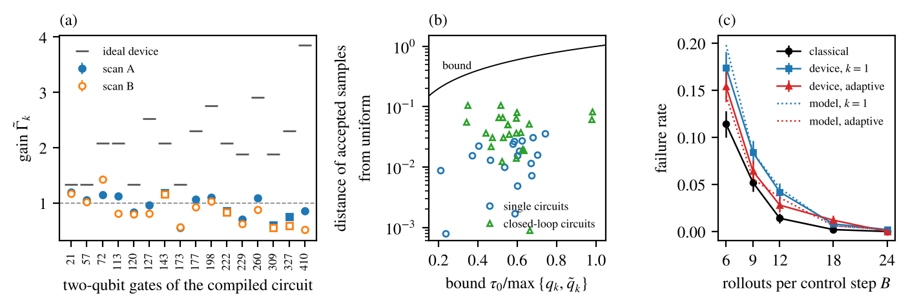

# Experiments on IBM Quantum hardware

The sampler was run on `ibm_kingston` (156 qubits) on November 27, 2026.
This folder holds the scripts, and `results/hardware/` holds the raw measurement counts and the analysis.
Three jobs make up the study, 523,968 shots in total.

| Record | IBM job | Shots | Content |
|---|---|---:|---|
| Scan A | `dc4i5llhdvas73bpq700` | 207,000 | 16 amplified circuits, horizons 2 to 5, 21 to 410 two-qubit gates |
| Scan B | `dc4iajanj2vs73dk6qbg` | 211,968 | the same circuits with dynamical decoupling and gate twirling |
| Controller pools | `dc4i7u6q4uuc73a8tp0g` | 105,000 | the circuit of every planning problem of the 18-step task |

An earlier pilot job (`dc4hkmdhdvas73bppe1g`, 24,000 shots, two circuits) is stored as `pilot_ibm_kingston_*.json`.



(a) Measured gain of the 16 circuits in both scans against an ideal device, ordered by two-qubit gate count.
(b) Distance of the accepted samples from uniform against the bound for arbitrary noise.
(c) Constraint violations of the controller replay with stored device samples.

## What the measurements show

* **Four circuits save rollouts in both scans**, with gains from 1.02 to 1.43: the reduced circuits for
  (N, M) = (2, 1), (3, 1) and (3, 2), and the standard circuit for (3, 1). Gate count alone does not decide
  the gain. Some larger circuits save rollouts in scan A only.
* **The standard five-step circuits do not save rollouts.** Their gains are 0.60 and 0.75 in scan A and
  0.56 and 0.59 in scan B (309 and 327 two-qubit gates after compilation for the device).
* **Accepted samples are close to uniform, not exactly uniform.** The uniformity test rejects for 4 of 9
  circuits in each scan, with a total variation distance of at most 0.036. The circuits that fail differ
  between the scans.
* **Readout twirling and the tested error suppression gave no consistent improvement.** The two scans
  differ in settings and in time, so their difference does not isolate the effect of the settings.
* **Controller replay.** With stored device samples, one iteration has more constraint violations than
  classical sampling at small budgets (17.4% against 11.4% at six rollouts per step) and the same from 18.
  A sampler model that uses one fitted number per circuit reproduces these rates.

No computational advantage is shown. Every instance here is solved exactly by a classical recursion.

## What the controller experiment is

It is a classical replay. The shots of every circuit were collected first. The closed loop then runs on a
classical computer and takes, at each control step, the next unused shots of the circuit that belongs to the
current state and time. Every shot is used at most once within a run of 500 episodes, and the pools are
reused across the budgets and samplers. It is not a real-time loop with the processor, and it does not
measure latency.

## Standard and reduced circuits

`full` in the code is the standard circuit of `qmppi/circuits.py`. `lean` is the reduced circuit built in
`run_study.py`. It removes flags that no path through allowed positions can set, uses the cheapest flag
condition that is correct on the reachable register values, starts from the known register value, and
uses the returned flag qubits as work qubits in the reflection. Before anything is submitted, every
circuit is checked on an ideal simulator to give exactly the ideal amplified distribution.

## Reproduce the analysis (no IBM account needed)

```bash
python hardware/run_study.py report      # tables for the three stored records
python hardware/make_figure.py           # figures/hardware.pdf and .png
pytest tests/test_hardware.py
```

`report` recomputes the analysis from the raw counts and rewrites the `analysis` block of each record.
Acceptance, gain and distances are deterministic. The p-values of the uniformity test and the standard
errors of the update come from resampling and can change in the third decimal between environments.

## Run on a device (IBM Quantum account needed)

```bash
pip install -r hardware/requirements.txt
python hardware/run_ibm.py --save-account          # stores the API key in your home folder, hidden input
python hardware/run_study.py usage                 # processor time used so far
python hardware/run_study.py scan --fake model     # instant stand-in, shows the output format
python hardware/run_study.py scan --dry-run        # compile and estimate, submit nothing
python hardware/run_study.py scan                  # asks before submitting
python hardware/run_study.py loop
python hardware/run_study.py scan --suppress       # dynamical decoupling and gate twirling
python hardware/run_study.py collect <job id>      # collect a job submitted earlier
```

The scan used 60 s and the controller pools 32 s of processor time. Each real run prints an estimate,
asks before it submits, and caps the job. The API key is never written into this repository.

## Files

| File | Purpose |
|---|---|
| `run_study.py` | the scan, the controller pools, the analysis and the replay |
| `run_ibm.py` | the pilot run of two standard circuits, and `--save-account` |
| `make_figure.py` | the figure above |
| `../results/hardware/scan_*.json`, `loop_*.json` | plan, raw counts per execution, and analysis of each job |
| `../results/hardware/job_*.json` | what was submitted (circuits, masks, gate counts, options) |
